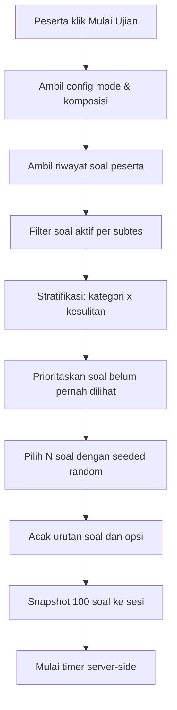
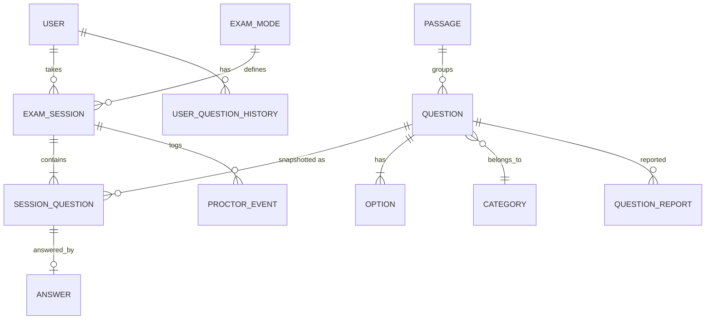
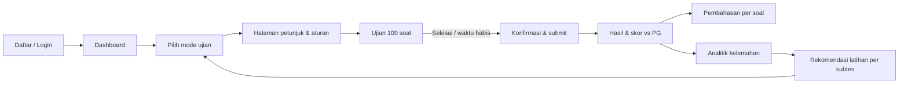

# PRD — Platform Simulasi Ujian CAT CPNS (SKD)

| Item | Detail |
|---|---|
| Nama produk (working title) | **CAT-CPNS Simulator** |
| Versi dokumen | 1.0 (Draft) |
| Tanggal | 25 November 2026 |
| Status | Draft untuk review |
| Referensi standar | Peraturan MenPAN-RB & Peraturan BKN tentang pelaksanaan seleksi CPNS; format CAT BKN (SKD: TWK, TIU, TKP) |

> [!NOTE]
> Parameter resmi (jumlah soal, bobot, passing grade) bisa berubah tiap formasi/tahun. Semua parameter dibuat **dapat dikonfigurasi (config-driven)**. Nilai default di dokumen ini mengikuti format SKD yang berlaku umum: 110 soal, 100 menit, passing grade per kategori. Verifikasi ke regulasi BKN terbaru sebelum rilis.

---

## 1. Latar Belakang & Masalah

Peserta CPNS butuh latihan yang mendekati kondisi asli CAT BKN: tampilan, sistem skor, batas waktu, dan variasi soal. Banyak platform tryout yang:

- Bank soalnya kecil, jadi soal berulang dan mudah dihafal.
- Tidak mengikuti sistem penilaian resmi, terutama skor TKP 1–5 dan passing grade per kategori.
- UI-nya tidak mirip CAT asli, sehingga peserta kaget saat ujian sebenarnya.
- Tidak punya analitik per subtes untuk mengetahui kelemahan peserta.

## 2. Tujuan Produk

1. Menyediakan simulasi ujian yang **semirip mungkin dengan CAT BKN**.
2. Menyediakan **bank soal besar** (target ≥ 5.000 soal pada rilis penuh), dengan setiap sesi **mengacak dan menampilkan hanya 100 soal**.
3. Menghitung skor dan kelulusan sesuai aturan SKD.
4. Memberi analitik dan pembahasan agar peserta bisa belajar.
5. Menjaga integritas ujian: anti-curang, anti-kebocoran soal, dan tahan terhadap gangguan koneksi.

### Metrik Keberhasilan

| Metrik | Target 3 bulan pasca-rilis |
|---|---|
| Ujian selesai / ujian dimulai | ≥ 85% |
| Peserta dengan ≥ 3 simulasi | ≥ 40% |
| Rata-rata kenaikan skor antara simulasi ke-1 dan ke-3 | ≥ +10% |
| Waktu muat soal (p95) | < 500 ms |
| Uptime saat sesi ujian | ≥ 99,5% |
| Jumlah soal bervalidasi dalam bank | ≥ 5.000 |
| Rata-rata overlap soal antar dua sesi berurutan peserta yang sama | < 15% |

## 3. Persona

| Persona | Kebutuhan |
|---|---|
| **Peserta** (pejuang CPNS, usia 20–35) | Latihan realistis, tahu posisi skor dibanding passing grade, pembahasan jelas, bisa di HP maupun laptop. |
| **Admin / Pengelola konten** | Mengelola bank soal besar (impor massal, tagging, versi), memantau kualitas soal. |
| **Reviewer / Pembuat soal** | Membuat dan mereview soal dengan alur persetujuan. |
| **Mentor / Instansi bimbel** (fase 2) | Membuat kelas, menjadwalkan ujian serentak, memantau progres siswa. |

## 4. Ruang Lingkup

### 4.1 In Scope (MVP)
- Registrasi, login, profil peserta.
- Bank soal TWK, TIU, TKP, beserta CMS admin.
- Mesin pengacak dan penyusun 100 soal per sesi.
- Antarmuka ujian ala CAT BKN, timer server-side, dan penyimpanan jawaban otomatis.
- Penilaian SKD, hasil, pembahasan, dan riwayat.
- Anti-curang dasar.

### 4.2 Out of Scope (MVP)
- SKB (Seleksi Kompetensi Bidang) per formasi (fase 3).
- Pembayaran, langganan, dan kelas live (fase 2).
- Aplikasi native (cukup PWA).
- Proctoring berbasis kamera/AI (fase 3).

---

## 5. Standar Ujian CPNS yang Diadopsi

### 5.1 Struktur SKD Resmi (konfigurasi referensi)

| Subtes | Jumlah soal | Penilaian per soal | Passing grade (acuan) |
|---|---|---|---|
| TWK (Tes Wawasan Kebangsaan) | 30 | Benar **5**, salah/kosong **0** | 65 |
| TIU (Tes Intelegensia Umum) | 35 | Benar **5**, salah/kosong **0** | 80 |
| TKP (Tes Karakteristik Pribadi) | 45 | Skala **1–5** per opsi | 156 |
| **Total** | **110** | | Nilai maks 550 |
| Durasi | **100 menit** | | |

### 5.2 Mode Ujian

Permintaan produk: setiap sesi hanya menampilkan **100 soal**. Karena SKD resmi 110 soal, sistem menyediakan dua mode:

| Mode | Soal | Durasi | Komposisi default | Tujuan |
|---|---|---|---|---|
| **Simulasi 100 Soal** (default sesuai permintaan) | **100** | **90 menit** (proporsional, bisa dikonfigurasi) | TWK 27 · TIU 32 · TKP 41 | Latihan harian |
| **Simulasi SKD Resmi** | 110 | 100 menit | TWK 30 · TIU 35 · TKP 45 | Gladi bersih yang paling mirip aslinya |
| **Latihan per subtes** | 20–50 | Fleksibel | Satu subtes | Fokus memperbaiki kelemahan |
| **Mini test** | 20 | 20 menit | Campuran | Belajar singkat |

> [!IMPORTANT]
> Untuk mode 100 soal, passing grade **diskalakan proporsional** dan ditampilkan sebagai "setara PG". Formula skala ada di §8.3. Hasil mode ini diberi label **"Estimasi"**, bukan hasil resmi.

### 5.3 Pemetaan Subtes ke Kategori

- **TWK**: Nasionalisme, Integritas, Bela Negara, Pilar Negara (Pancasila, UUD 1945, NKRI, Bhinneka Tunggal Ika), Bahasa Indonesia, Sejarah, Sistem Pemerintahan, Hukum & Konstitusi.
- **TIU**: Verbal (analogi, silogisme, analitis), Numerik (deret, aritmetika, perbandingan, soal cerita), Figural (analogi, serial, ketidaksamaan gambar).
- **TKP**: Pelayanan Publik, Jejaring Kerja, Sosial Budaya, Teknologi Informasi & Komunikasi (TIK), Profesionalisme, Anti-Radikalisme.

---

## 6. Fitur Fungsional

Prioritas: **P0** = wajib MVP, **P1** = penting, **P2** = nanti.

### 6.1 Akun & Autentikasi

| ID | Kebutuhan | Prioritas |
|---|---|---|
| AUTH-01 | Registrasi dengan email dan password; verifikasi email. | P0 |
| AUTH-02 | Login Google (OAuth). | P1 |
| AUTH-03 | Reset password. | P0 |
| AUTH-04 | Profil: nama, target instansi, target formasi, tanggal rencana ujian. | P1 |
| AUTH-05 | Role: peserta, admin, reviewer, mentor. | P0 |
| AUTH-06 | Satu akun hanya boleh punya satu sesi ujian aktif pada satu waktu. | P0 |

### 6.2 Bank Soal & Mesin Pengacak (Inti Produk)

| ID | Kebutuhan | Prioritas |
|---|---|---|
| BANK-01 | Bank soal terpusat dengan target **≥ 5.000 soal** (TWK ≥ 1.200 · TIU ≥ 1.800 · TKP ≥ 2.000). | P0 |
| BANK-02 | Tiap soal punya metadata: subtes, kategori, sub-kategori, tingkat kesulitan (mudah/sedang/sulit), sumber, status (draft/review/aktif/arsip), versi. | P0 |
| BANK-03 | Tipe soal: teks, teks + gambar (figural, grafik, tabel), bacaan/wacana dengan beberapa soal turunan. | P0 |
| BANK-04 | Tiap soal punya 5 opsi (A–E). Soal TWK dan TIU punya 1 kunci. Soal TKP punya **bobot 1–5 per opsi**. | P0 |
| BANK-05 | Tiap soal punya pembahasan (teks, gambar, atau video opsional). | P0 |
| BANK-06 | Impor massal CSV/XLSX/JSON dengan validasi dan laporan error per baris. | P0 |
| BANK-07 | Deteksi soal duplikat atau mirip (fuzzy match) saat impor. | P1 |
| BANK-08 | Alur kerja: Draft → Review → Disetujui → Aktif → Arsip. | P1 |
| BANK-09 | Statistik kualitas per soal: p-value (tingkat kesulitan sebenarnya), daya beda, distribusi jawaban. Soal bermasalah ditandai otomatis. | P1 |
| BANK-10 | Peserta bisa melaporkan soal salah/ambigu, lalu masuk antrean review. | P1 |

#### Algoritma Pemilihan Soal (inti)

Setiap sesi ujian dibuat oleh **Question Assembler** dengan aturan:

1. **Stratifikasi**: ambil jumlah soal per subtes sesuai komposisi mode (mode 100 soal: TWK 27, TIU 32, TKP 41).
2. **Sebaran kategori**: dalam tiap subtes, soal didistribusikan proporsional antar kategori (contoh TIU: verbal ≈ 30%, numerik ≈ 40%, figural ≈ 30%).
3. **Sebaran kesulitan**: default 30% mudah · 50% sedang · 20% sulit (dapat dikonfigurasi).
4. **Prioritas soal baru**: soal yang **belum pernah dilihat** peserta diprioritaskan. Soal yang sudah pernah dilihat baru dipakai bila stok habis, dengan bobot cooldown (makin lama tidak muncul, makin besar peluang).
5. **Pengacakan** memakai *seeded shuffle* (`seed` disimpan di sesi) supaya urutan bisa direproduksi untuk audit dan resume.
6. **Acak urutan soal** dan **acak urutan opsi** (kecuali soal yang opsinya tergantung urutan, misalnya "semua benar" atau "A dan B benar"; ada flag `lock_option_order`).
7. **Soal berwacana** (bacaan dan grafik) selalu diambil satu paket dan tidak dipisah.
8. **Tanpa duplikat** dalam satu sesi, termasuk soal serupa (`similarity_group_id` yang sama hanya diambil satu).
9. **Snapshot**: soal terpilih di-*snapshot* ke sesi, jadi perubahan atau penghapusan soal di bank tidak mengubah ujian yang sedang berjalan.
10. **Format urutan tampil**: urutan subtes mengikuti pengaturan (default: TWK → TIU → TKP bercampur dalam satu daftar nomor, seperti CAT BKN yang bebas navigasi antar nomor).



### 6.3 Antarmuka Ujian (Meniru CAT BKN)

| ID | Kebutuhan | Prioritas |
|---|---|---|
| EXAM-01 | Halaman petunjuk dan persetujuan aturan sebelum mulai, dengan hitung mundur ke ujian. | P0 |
| EXAM-02 | Layout: area soal di kiri/tengah, **panel navigasi nomor** di kanan, **timer hitung mundur** di header. | P0 |
| EXAM-03 | Panel nomor berwarna: **hijau** = sudah dijawab, **kuning** = ragu-ragu, **putih** = belum dijawab, **biru** = sedang dibuka. | P0 |
| EXAM-04 | Tombol: *Sebelumnya*, *Simpan & Lanjut*, *Ragu-ragu*, *Selesai*. | P0 |
| EXAM-05 | Peserta bebas berpindah ke nomor mana pun kapan saja. | P0 |
| EXAM-06 | Jawaban **tersimpan otomatis** ke server tiap perubahan (debounce < 1 detik) dan juga tersimpan lokal sebagai cadangan. | P0 |
| EXAM-07 | **Timer server-side** (otoritatif). Klien hanya menampilkan. Saat habis, ujian auto-submit. | P0 |
| EXAM-08 | Konfirmasi sebelum "Selesai" dengan ringkasan: terjawab, belum dijawab, ragu-ragu. | P0 |
| EXAM-09 | Resume: bila browser tertutup atau koneksi putus, peserta bisa lanjut dengan sisa waktu yang benar. | P0 |
| EXAM-10 | Pengaturan tampilan: ukuran font, mode terang/gelap (tidak mengubah soal). | P1 |
| EXAM-11 | Soal bergambar bisa di-zoom. | P1 |
| EXAM-12 | Peringatan waktu: 15 menit, 5 menit, 1 menit. | P1 |
| EXAM-13 | Responsif HP, tablet, desktop; PWA yang bisa di-install. | P1 |
| EXAM-14 | Mode offline-tolerant: antrean jawaban lokal yang disinkron otomatis saat koneksi kembali. | P1 |
| EXAM-15 | Aksesibilitas: navigasi keyboard (angka 1–5 / A–E untuk memilih, ←/→ untuk berpindah), kontras WCAG AA. | P1 |
| EXAM-16 | Mode **Ujian Serentak terjadwal** (satu jadwal, semua peserta mulai bersamaan). | P2 |

### 6.4 Penilaian & Hasil

| ID | Kebutuhan | Prioritas |
|---|---|---|
| SCORE-01 | TWK dan TIU: benar +5, salah atau kosong 0. | P0 |
| SCORE-02 | TKP: skor = bobot opsi yang dipilih (1–5); kosong = 0. | P0 |
| SCORE-03 | Skor per subtes dan total; status **Lulus/Tidak Lulus PG** per subtes dan keseluruhan (peserta harus lolos **ketiga** passing grade). | P0 |
| SCORE-04 | Untuk mode 100 soal: tampilkan skor mentah dan **skor ternormalisasi** ke skala SKD (lihat §8.3). | P0 |
| SCORE-05 | Halaman hasil: skor, waktu pengerjaan, jumlah benar/salah/kosong, grafik radar per kategori. | P0 |
| SCORE-06 | **Pembahasan per soal**: jawaban peserta, kunci, penjelasan. Dibuka setelah ujian selesai. | P0 |
| SCORE-07 | Riwayat semua simulasi dan grafik tren skor. | P1 |
| SCORE-08 | **Ranking** per mode atau jadwal (opsional, bisa anonim). | P1 |
| SCORE-09 | Analitik kelemahan: kategori terlemah dan rekomendasi latihan otomatis. | P1 |
| SCORE-10 | Ekspor hasil ke PDF. | P2 |
| SCORE-11 | Analitik waktu per soal (soal yang paling lama dikerjakan). | P2 |

### 6.5 Admin & CMS

| ID | Kebutuhan | Prioritas |
|---|---|---|
| ADM-01 | CRUD soal dengan editor teks kaya (rich text), unggah gambar, rumus (LaTeX/KaTeX) untuk TIU numerik. | P0 |
| ADM-02 | Impor dan ekspor massal; template CSV disediakan. | P0 |
| ADM-03 | Kelola konfigurasi mode ujian: komposisi, durasi, passing grade, distribusi kesulitan. | P0 |
| ADM-04 | Dasbor: jumlah soal per subtes/kategori/status, soal yang kurang stok. | P1 |
| ADM-05 | Kelola pengguna dan role. | P0 |
| ADM-06 | Antrean laporan soal dari peserta. | P1 |
| ADM-07 | Audit log semua perubahan soal dan konfigurasi. | P1 |
| ADM-08 | Peringatan stok: bila soal belum pernah dilihat < 150% dari kebutuhan satu sesi per subtes. | P1 |

### 6.6 Anti-Curang & Integritas

| ID | Kebutuhan | Prioritas |
|---|---|---|
| SEC-01 | Kunci jawaban **tidak pernah dikirim ke klien** selama ujian; skoring hanya di server. | P0 |
| SEC-02 | Satu sesi aktif per akun; login ganda memaksa logout sesi lama. | P0 |
| SEC-03 | Deteksi pindah tab/jendela (visibility API), dicatat dan ditampilkan peringatan; batas pelanggaran dapat dikonfigurasi. | P1 |
| SEC-04 | Nonaktifkan klik kanan, salin-tempel, dan cetak pada halaman ujian (*best effort*). | P1 |
| SEC-05 | Watermark ringan berisi nama/ID peserta pada halaman soal untuk mencegah tangkapan layar tersebar. | P1 |
| SEC-06 | Rate limiting, proteksi brute force, dan CAPTCHA pada registrasi. | P0 |
| SEC-07 | Log aktivitas ujian (event: mulai, jawab, pindah nomor, blur, submit) untuk audit. | P1 |
| SEC-08 | Deteksi pola mencurigakan: waktu jawab tidak wajar, jawaban beruntun tidak wajar. | P2 |
| SEC-09 | Proctoring kamera (opt-in). | P3 |

---

## 7. Kebutuhan Non-Fungsional

| Area | Kebutuhan |
|---|---|
| **Performa** | Muat halaman ujian < 2 dtk (4G). Respons simpan jawaban p95 < 300 ms. Seluruh 100 soal di-*prefetch* saat mulai supaya perpindahan nomor instan. |
| **Skalabilitas** | Dukung ≥ 5.000 peserta serentak pada fase serentak; autoscaling horizontal; bank soal ≥ 50.000 soal tanpa degradasi. |
| **Ketersediaan** | ≥ 99,5% saat jadwal ujian; backup DB harian dan PITR. |
| **Keandalan data** | Tidak boleh ada jawaban hilang (idempotent write, antrean klien + ack server). |
| **Keamanan** | HTTPS, hash password (Argon2/bcrypt), proteksi OWASP Top 10, enkripsi data saat transit dan diam, kepatuhan UU PDP. |
| **Kompatibilitas** | Chrome, Edge, Firefox, Safari (2 versi terakhir); Android 9+, iOS 14+. |
| **Aksesibilitas** | WCAG 2.1 AA. |
| **Lokalisasi** | Bahasa Indonesia sebagai bahasa utama. Zona waktu WIB/WITA/WIT ditampilkan bila relevan. |
| **Observability** | Log terstruktur, metrik, tracing, alert pada error rate dan latensi. |

---

## 8. Model Data & Aturan Bisnis

### 8.1 Entitas Utama



| Entitas | Atribut penting |
|---|---|
| `Question` | id, subtest (TWK/TIU/TKP), category_id, difficulty, passage_id?, body (rich), image_url?, explanation, status, version, similarity_group_id, lock_option_order, stats (p_value, discrimination, times_served) |
| `Option` | id, question_id, label, body, is_correct (TWK/TIU), weight 1–5 (TKP) |
| `ExamMode` | id, name, total_questions, composition {TWK,TIU,TKP}, duration_min, difficulty_mix, passing_grade {twk,tiu,tkp,total}, scoring_scheme |
| `ExamSession` | id, user_id, mode_id, seed, started_at, deadline_at, submitted_at, status (active/submitted/expired), violations_count |
| `SessionQuestion` | session_id, position, question_snapshot (JSON), option_order |
| `Answer` | session_question_id, option_id, flagged_doubt, answered_at, revision |
| `UserQuestionHistory` | user_id, question_id, last_seen_at, times_seen, last_correct |

### 8.2 Aturan Sesi
- Sesi punya `deadline_at = started_at + duration`. Server menolak jawaban setelah `deadline_at + grace 5 dtk`.
- Sesi `active` yang melewati deadline di-*auto-submit* oleh worker latar belakang.
- Satu peserta maksimal 1 sesi `active`.
- Jawaban dapat diubah selama sesi aktif; setiap perubahan menambah `revision`.

### 8.3 Normalisasi Skor Mode 100 Soal

Untuk subtes *s* dengan *n_s* soal di mode 100 dan *N_s* soal di SKD resmi:

$$\text{Skor}_{\text{setara}, s} = \frac{\text{Skor mentah}_s}{n_s \times 5} \times (N_s \times 5)$$

Passing grade setara = passing grade resmi (65 / 80 / 156). Contoh: TIU 32 soal, benar 24 → mentah 120 → setara \( \frac{120}{160} \times 175 = 131{,}25 \) → lulus PG TIU (≥ 80).

> [!NOTE]
> Untuk TKP, skor maksimum per soal adalah 5, sehingga rumus yang sama berlaku.

---

## 9. Alur Pengguna Utama



### Contoh User Story & Kriteria Penerimaan

**US-01 — Soal acak 100.** *Sebagai peserta, saya ingin tiap ujian menampilkan 100 soal acak dari bank besar agar tidak bisa menghafal.*
- Given bank ≥ 5.000 soal aktif, When saya memulai sesi, Then sistem menampilkan tepat 100 soal dengan komposisi TWK 27 / TIU 32 / TKP 41.
- Then tidak ada soal duplikat dalam satu sesi.
- Then ≥ 85% soal adalah soal yang belum pernah saya lihat (selama stok tersedia).
- Then urutan soal dan opsi berbeda untuk sesi berbeda.

**US-02 — Lanjut setelah gangguan.** *Sebagai peserta, bila internet putus saya ingin lanjut tanpa kehilangan jawaban.*
- Then semua jawaban yang sudah ditandai tersimpan terlihat setelah reload; timer menunjukkan sisa waktu server.

**US-03 — Penilaian resmi.** *Sebagai peserta, saya ingin tahu lulus atau tidak per subtes.*
- Then skor TKP dihitung dengan bobot 1–5; hasil menandai tiap subtes di bawah PG dengan warna merah.

**US-04 — Impor soal.** *Sebagai admin, saya ingin impor 1.000 soal sekaligus.*
- Then sistem memvalidasi, melaporkan baris error, dan memberi tahu soal yang terdeteksi duplikat.

---

## 10. Konten: Strategi Bank Soal

Mencapai ribuan soal berkualitas adalah risiko terbesar produk.

| Sumber | Catatan |
|---|---|
| Penulisan oleh tim ahli/guru | Kualitas tertinggi, lambat; wajib review 2 orang. |
| Penulisan dibantu AI (draf) | Wajib review manusia sebelum aktif; verifikasi kunci jawaban otomatis dan manual. |
| Soal prosedural (TIU numerik: deret, aritmetika) | Dibangkitkan secara generatif lewat templat parametrik untuk variasi tak terbatas dengan kunci terjamin benar. |
| Kontribusi komunitas/mentor | Lewat alur Draft → Review. |
| Hak cipta | Dilarang menyalin soal bimbel/buku berhak cipta. Soal "mirip" resmi harus dibuat ulang. |

**Target pertumbuhan:** MVP 1.500 soal → 3 bulan 3.000 → 6 bulan ≥ 5.000.

**Kontrol kualitas:** peer review 2 tahap, uji coba pada pengguna (kalibrasi p-value), tandai otomatis soal dengan daya beda negatif atau > 30% laporan.

> [!WARNING]
> Soal TWK terkait regulasi, peristiwa terkini, dan kebijakan cepat usang. Setiap soal TWK diberi `review_by` (tanggal kedaluwarsa) agar ditinjau ulang berkala.

---

## 11. Arsitektur & Teknologi (Rekomendasi)

| Lapisan | Rekomendasi |
|---|---|
| Frontend | Next.js (React) + TypeScript + Tailwind; PWA; state ujian dengan Zustand + penyimpanan lokal IndexedDB |
| Backend | Node.js (NestJS) atau Laravel; REST/JSON (atau tRPC) |
| Database | PostgreSQL (soal, sesi, hasil); Redis (cache, rate limit, kunci sesi aktif, antrean) |
| Storage | S3-compatible untuk gambar soal + CDN |
| Worker | BullMQ / queue untuk auto-submit, skoring, statistik soal |
| Auth | JWT berumur pendek + refresh token, atau Auth.js |
| Infra | Docker, CI/CD, deploy di cloud (autoscaling); monitoring Grafana/Sentry |
| Pencarian | PostgreSQL full-text / pgvector untuk deteksi soal mirip |

### Endpoint Inti (draf)

| Method | Path | Fungsi |
|---|---|---|
| POST | `/api/exams/start` | Buat sesi dari mode; jalankan Question Assembler |
| GET | `/api/exams/{id}` | Ambil sesi (soal tanpa kunci, sisa waktu server) |
| PUT | `/api/exams/{id}/answers/{pos}` | Simpan jawaban dan status ragu-ragu (idempotent) |
| POST | `/api/exams/{id}/submit` | Selesai dan hitung skor |
| GET | `/api/exams/{id}/result` | Hasil + pembahasan (hanya setelah submit) |
| POST | `/api/questions/{id}/report` | Laporkan soal |
| `*` | `/api/admin/questions`, `/import`, `/modes` | CMS |

---

## 12. Desain & UX

- Visual meniru CAT BKN yang sederhana dan fungsional: header berisi nama, nomor peserta, dan timer; panel nomor dengan kode warna; kontras tinggi.
- Mobile: panel nomor jadi *drawer* yang bisa dibuka lewat tombol.
- Gaya bahasa formal, ramah.
- Halaman hasil memakai kartu skor + indikator PG (hijau lulus/merah belum lulus) + grafik radar.
- Mode latihan menampilkan umpan balik instan (opsional), sedangkan mode simulasi menyembunyikan jawaban sampai selesai.

---

## 13. Roadmap

| Fase | Cakupan | Perkiraan |
|---|---|---|
| **Fase 0 — Fondasi** | Setup repo, skema DB, desain UI, template impor soal, seed 300 soal | 2 minggu |
| **Fase 1 — MVP** | Auth, bank soal + CMS dasar, Question Assembler, UI ujian CAT, skoring, hasil + pembahasan, 1.500 soal | 8 minggu |
| **Fase 2 — Penguatan** | Analitik kelemahan, riwayat/tren, ranking, laporan soal, anti-curang lanjutan, PWA offline, 3.000 soal | 6 minggu |
| **Fase 3 — Skala** | Ujian serentak terjadwal, kelas mentor, pembayaran/langganan, ≥ 5.000 soal | 8 minggu |
| **Fase 4 — Lanjutan** | SKB per formasi, proctoring, adaptive practice | TBD |

---

## 14. Risiko & Mitigasi

| Risiko | Dampak | Mitigasi |
|---|---|---|
| Bank soal tidak cukup/berkualitas rendah | Soal berulang, kredibilitas turun | Pipeline konten, generator parametrik, review 2 tahap, monitor stok |
| Kunci jawaban salah | Skor tidak adil | Review ganda, laporan peserta, statistik anomali |
| Lonjakan trafik saat ujian serentak | Server down | Load test, autoscaling, cache soal, antrean tulis |
| Kebocoran soal | Bank rusak | Soal tidak diekspos penuh, watermark, rate limit, pool besar |
| Perubahan regulasi SKD | Parameter usang | Konfigurasi dinamis, monitor pengumuman BKN |
| Pelanggaran hak cipta | Masalah hukum | Larang penyalinan, soal orisinal |
| Peserta curang di mode ranking | Ranking tidak valid | Anti-curang, tandai hasil mencurigakan |

## 15. Pertanyaan Terbuka

1. Mode 100 soal: apakah komposisi TWK 27 / TIU 32 / TKP 41 dan durasi 90 menit sesuai keinginan, atau 100 soal dengan komposisi dan durasi lain?
2. Model bisnis: gratis, freemium, atau berbayar?
3. Stack teknologi: apakah ada preferensi (misalnya Laravel, Next.js, atau lainnya)?
4. Sumber soal: dibuat sendiri, dibantu AI, atau dari kontributor?
5. Perlu fitur kelas/mentor dan ujian serentak sejak awal?
6. Apakah SKB masuk cakupan dan untuk formasi mana?

---

## Lampiran A — Template Impor Soal (CSV)

```csv
subtest,category,difficulty,question,option_a,option_b,option_c,option_d,option_e,correct,weight_a,weight_b,weight_c,weight_d,weight_e,explanation,image_url,passage_id,lock_option_order
TWK,Pilar Negara,mudah,"Sila ke-3 Pancasila berbunyi ...",Ketuhanan...,Kemanusiaan...,Persatuan Indonesia,Kerakyatan...,Keadilan...,C,,,,,,"Sila ke-3 adalah Persatuan Indonesia.",,,false
TKP,Pelayanan Publik,sedang,"Anda menghadapi warga yang marah karena antrean ...",...,...,...,...,...,,5,4,3,2,1,"Opsi A paling sesuai karena ...",,,false
```

## Lampiran B — Checklist Definition of Done (MVP)

- [ ] Sesi menampilkan tepat 100 soal sesuai komposisi, tanpa duplikat.
- [ ] Skoring TWK/TIU/TKP benar terhadap 20 kasus uji manual.
- [ ] Timer server-side akurat (selisih < 2 dtk) dan auto-submit berjalan.
- [ ] Resume setelah reload/koneksi putus teruji.
- [ ] Kunci jawaban tidak ada di respons API selama ujian.
- [ ] Bank ≥ 1.500 soal aktif yang sudah di-review.
- [ ] Uji beban 1.000 peserta serentak lulus.
- [ ] Uji aksesibilitas dan responsif lulus.
