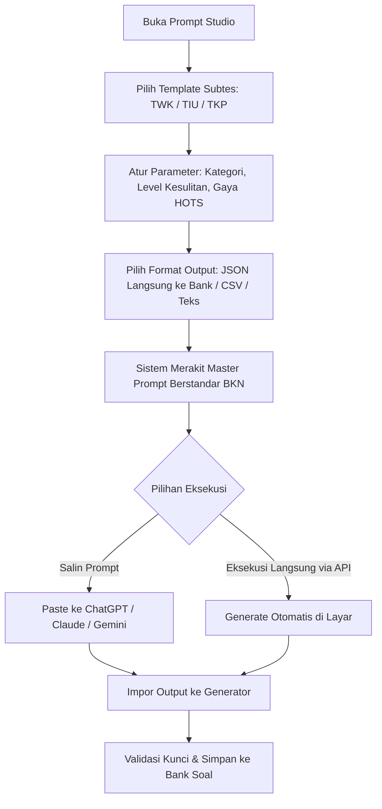

# PRD: AI Prompt Studio & Question Generator CPNS

| Item | Deskripsi |
|---|---|
| **Fitur** | **AI Prompt Studio & Question Generator** (Modul Generator Soal SKD Terstandar) |
| **Versi Dokumen** | 1.0 |
| **Target Platform** | Web App (Desktop & Tablet) |
| **Pengguna Sasaran** | Admin Bank Soal, Mentor Bimbel CPNS, dan Peserta Mandiri |

---

## 1. Latar Belakang & Masalah

1. **Pembuatan Soal Manual Sangat Lambat**: Menulis butir soal CPNS berkualitas tinggi dengan pembahasan langkah demi langkah membutuhkan waktu 15–20 menit per butir soal.
2. **Prompt Mentah ke LLM Sering Gagal / Halusinasi**:
   - Kunci jawaban yang dihasilkan AI sering salah pada soal hitungan TIU.
   - Opsi TKP sering tidak memiliki gradasi nilai yang jelas (skala 1 s/d 5).
   - Soal TWK sering tidak merujuk pada regulasi resmi atau butir Pancasila yang valid.
   - Format output tidak terstruktur sehingga sulit diimpor massal ke sistem CAT.
3. **Solusi**: Menyediakan **Guided Prompt Studio** yang menghasilkan prompt terstruktur dengan rekayasa sistem (*few-shot prompting*, *chain-of-thought*, dan format strict JSON/CSV) sehingga LLM menghasilkan soal CPNS berkualitas tinggi, akurat, dan siap pakai.

---

## 2. Sasaran Produk (Goals & Metrics)

- **Efisiensi**: Mempercepat perakitan paket soal dari hitungan hari menjadi < 5 menit.
- **Akurasi Validasi**: ≥ 98% output soal memiliki format valid (5 opsi A–E, 1 kunci untuk TWK/TIU, bobot 1–5 untuk TKP).
- **Kualitas Pembahasan**: 100% soal memiliki penjelasan langkah demi langkah (*step-by-step resolution*).

---

## 3. Alur Pengguna (User Flow)



---

## 4. Rincian Fitur Utama

### 4.1 Guided Parameter Builder (Formulir Pengatur Parameter)
Pengguna tidak perlu mengetik prompt dari nol, cukup memilih opsi pada panel input:

1. **Pemilihan Subtes & Kisi-Kisi Resmi**:
   - **TWK**: Nasionalisme, Integritas, Bela Negara, Pilar Negara (Pancasila, UUD 1945, NKRI, Bhinneka Tunggal Ika), Bahasa Indonesia.
   - **TIU**: Verbal (Analogi, Silogisme, Analitis), Numerik (Deret Bertingkat, Aritmetika, Perbandingan, Kecepatan Rata-rata), Figural.
   - **TKP**: 6 Indikator PermenPAN-RB (Pelayanan Publik, Jejaring Kerja, Sosial Budaya, TIK, Profesionalisme, Anti-Radikalisme).
2. **Tingkat Kesulitan & Karakteristik Soal**:
   - Mudah / Sedang / Sulit (HOTS - *Higher Order Thinking Skills*).
   - Panjang wacana narasi: Pendek (1–2 kalimat), Sedang (1 paragraf), Studi Kasus Panjang (2–3 paragraf).
3. **Spesifikasi Pembahasan**:
   - Wajib menyertakan *Langkah 1, Langkah 2, Langkah 3*.
   - Menyertakan konsep hukum/pasal (untuk TWK) atau rumus trik cepat (untuk TIU).
   - Menyertakan justifikasi poin 5 dan alasan poin 1–4 (untuk TKP).
4. **Kuantitas Soal**:
   - 1 Butir (Uji Coba Cepat), 5 Butir, 10 Butir, hingga 25 Butir sekaligus.

---

### 4.2 Sistem Master Prompt Engine (Arsitektur Rekayasa Prompt)

Sistem secara otomatis merangkai prompt yang mengunci perilaku LLM dengan struktur:

```
[SYSTEM ROLE]
Anda adalah pembuat soal resmi CAT SKD CPNS Badan Kepegawaian Negara (BKN) dengan standar PermenPAN-RB.

[TASK INSTRUCTION]
Buatkan {JUMLAH} soal {SUBTES} materi {KATEGORI} dengan tingkat kesulitan {DIFFICULTY}.

[STRICT CONSTRAINTS]
1. Harus memiliki tepat 5 pilihan jawaban (A, B, C, D, E).
2. Untuk TWK & TIU: Hanya ada SATU jawaban benar (+5), 4 opsi lainnya salah mutlak (0).
3. Untuk TKP: Setiap opsi A s/d E WAJIB memiliki bobot 1, 2, 3, 4, dan 5 secara unik tanpa duplikasi bobot.
4. Pembahasan WAJIB menyajikan langkah penyelesaian bertahap secara runut.
5. Format output WAJIB dalam JSON murni tanpa markdown pembungkus.

[OUTPUT SCHEMA]
{
  "questions": [
    {
      "subtest": "TWK | TIU | TKP",
      "category": "...",
      "difficulty": "mudah | sedang | sulit",
      "body": "Teks pertanyaan...",
      "options": [
        { "label": "A", "text": "...", "correct": true/false, "weight": 5 },
        ...
      ],
      "explanation": "Langkah 1: ...\nLangkah 2: ...\nJawaban: ..."
    }
  ]
}
```

---

### 4.3 Output Validator & Live Preview
- **JSON Syntax Highlighter**: Menampilkan kode soal dengan pewarnaan sintaks.
- **Format Checker**: Tombol validasi otomatis yang memeriksa:
  - Apakah ada 5 opsi per nomor?
  - Apakah kunci jawaban TWK/TIU ada dan benar?
  - Apakah bobot TKP lengkap 1, 2, 3, 4, 5?
- **Tombol Aksi**:
  - `Salin Prompt Lengkap` (untuk di-paste ke ChatGPT/Claude/Gemini).
  - `Impor Hasil JSON ke Bank Soal` (langsung masuk ke simulasi pengerjaan CAT).
  - `Unduh CSV / JSON` (untuk backup arsip).

---

## 5. Rancangan Tata Letak UX (UI/UX Layout Architecture)

Tampilan dibagi menjadi **2 Kolom Seimbang (Split Screen Studio)**:

```
+-----------------------------------------------------------------------------------+
|  NAVBAR: Studio Pembuat Prompt Soal CPNS                [Preset Cepat] [Bantuan]  |
+------------------------------------------+----------------------------------------+
|  KOLOM KIRI: Parameter Builder           |  KOLOM KANAN: Prompt & Output Preview  |
|                                          |                                        |
|  1. Subtes: [TWK] [TIU] [TKP]            |  [Tab: Prompt Hasil] [Tab: Hasil JSON] |
|  2. Kategori: [Dropdown Kategori BKN]    |                                        |
|  3. Model Soal: [HOTS / Studi Kasus]     |  +----------------------------------+  |
|  4. Tingkat Kesulitan: [Sedang / Sulit]  |  | "Role: Anda adalah pembuat soal  |  |
|  5. Jumlah Butir: [1 / 5 / 10 / 25]      |  | resmi CAT BKN...                 |  |
|  6. Format: [JSON CAT Terstandar]        |  | Schema: { questions: [...] } "   |  |
|                                          |  +----------------------------------+  |
|  +------------------------------------+  |                                        |
|  | [Salin Prompt]  [Simpan Template]  |  |  [📋 Salin ke Clipboard]               |
|  +------------------------------------+  |  [⚡ Uji Eksekusi Prompt]              |
|                                          |  [📥 Masukkan JSON Hasil ke Bank Soal] |
+------------------------------------------+----------------------------------------+
```

---

## 6. Template Preset Bawaan (Quick Templates)

1. **Preset HOTS TIU Numerik Deret & Soal Cerita**:
   - Menghasilkan soal deret aritmetika bertingkat dan soal cerita kecepatan harmonik dengan pembuktian rumus matematis.
2. **Preset TWK Studi Kasus Pengamalan Pancasila**:
   - Menghasilkan studi kasus dilema kebangsaan modern yang menguji butir sila ke-1 hingga ke-5.
3. **Preset TKP Situasional Dilema Layanan Publik**:
   - Menghasilkan situasi benturan kepentingan (misal: keluarga vs antrean warga) dengan skor tergradasi 1–5.
4. **Preset Simulasi 100 Soal Campuran**:
   - Menghasilkan template prompt perakitan paket 100 soal lengkap berimbang (TWK 27, TIU 32, TKP 41).

---

## 7. Roadmap Pelaksanaan

- **Fase 1 (MVP)**:
  - Form Parameter Builder (Subtes, Kategori, Tingkat Kesulitan, Jumlah).
  - Generator Master Prompt dengan strict JSON output schema.
  - Tombol 1-klik salin prompt dan validasi JSON tester.
- **Fase 2 (Integrasi)**:
  - Integrasi API Direct LLM (Gemini / OpenAI API key opsional dari pengguna).
  - Auto-import soal langsung masuk ke bank soal `CAT Simulator`.
- **Fase 3 (Lanjutan)**:
  - Deteksi kemiripan soal (anti-duplikat).
  - Ekspor ke format CSV / PDF cetak lembar soal & pembahasan.
